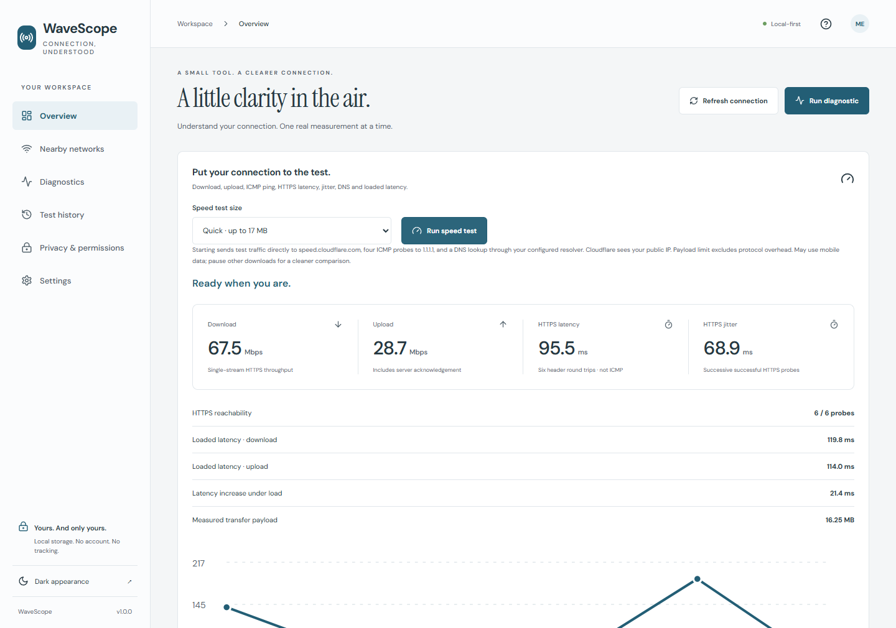

# WaveScope

[](https://github.com/gopichandchikoti/WaveScope/actions/workflows/ci.yml)

**A private, one-stop toolkit for testing your internet connection, your Wi-Fi and your router.**

Press one button to measure download and upload speed, latency, jitter, DNS time and how much your connection slows down under load. Look at the Wi-Fi you are on and the networks around you. Run individual ping, DNS and HTTPS checks against any host. Everything runs on your own device, results stay on your device, and nothing is measured until you ask.



WaveScope runs as a desktop web app backed by a small loopback-only Windows companion, and as an Android app. Both use the same interface.

> Local browser app: **http://127.0.0.1:5182** · Android package: **com.portfolio.wavescope** · Version **1.0.0**

## Download (Android)

**[Download the latest APK](https://github.com/gopichandchikoti/WaveScope/releases/download/latest-build/WaveScope-preview.apk)**

This link never changes. GitHub Actions rebuilds the APK on **every push to `main`** and replaces the file behind it, so it always gives you the newest build. Also: [SHA-256 checksum](https://github.com/gopichandchikoti/WaveScope/releases/download/latest-build/WaveScope-preview.apk.sha256) · [build details and notes](https://github.com/gopichandchikoti/WaveScope/releases/tag/latest-build) · [all releases](https://github.com/gopichandchikoti/WaveScope/releases). Tagged versions such as `v1.0.0` become official releases, and the newest one is at [`releases/latest`](https://github.com/gopichandchikoti/WaveScope/releases/latest/download/WaveScope.apk).

**Install it:** open the link on an Android 8.0 or newer phone, allow installs from your browser or file manager when Android asks, then open the downloaded file. To check the download first, compare `Get-FileHash WaveScope-preview.apk -Algorithm SHA256` (or `sha256sum`) with the checksum file.

These are **debug-signed preview builds**, not store releases. Unless the maintainer has added a signing key (see [Releases and CI](#releases-and-ci)), every build is signed with a different throwaway key, so Android will not update over an earlier install: uninstall the old copy first. WaveScope keeps its history on the device, so uninstalling removes it; export your CSV first if you want it.

For Windows, run it from source (below).

## What it does

| Area | What you get |
|---|---|
| **Speed test** (Overview) | One button: DNS lookup, ICMP ping, six HTTPS latency probes, three timed downloads, three timed uploads, and latency measured *during* the transfers. Results: Mbps down and up, HTTPS latency and jitter, reachability, loaded latency, increase under load, and a plain-language hint. Quick (up to 17 MB) or Extended (up to 39 MB). Cancel at any time |
| **Connection overview** | Connection type, local IP, DNS servers, default gateway, VPN indication, and, where the OS allows, Wi-Fi name, BSSID, signal, link rate, band and channel |
| **Router check** | **Check router latency** prefills the OS-reported gateway so you can time your router separately from the internet |
| **Nearby networks** | OS-provided access points with signal and channel, and a per-channel count |
| **Diagnostics** | ICMP ping (packet loss, jitter), DNS resolution time, and HTTPS reachability, each clearly labeled as a different measurement |
| **History** | Speed test notebook and diagnostic history with comparison charts, filters, CSV export and retention control |
| **Privacy** | A page that lists what is read, stored and sent, and which adapter you are using |

Anything the operating system will not reveal is shown as **Unavailable**, never estimated. WaveScope does not capture packets, look at other apps' traffic, log in to your router, or act as a spectrum analyzer.

## Quick start (Windows)

You need **Node.js 22.12 or newer** and npm. In PowerShell, from this folder:

```powershell
npm.cmd ci
npm.cmd run build
npm.cmd start
```

Open **http://127.0.0.1:5182** and press **Run speed test**.

## Use the app

1. **Run a speed test.** On **Overview**, choose Quick or Extended and press **Run speed test**. The card first tells you exactly where traffic goes: `speed.cloudflare.com` for the transfers, `1.1.1.1` for four ICMP pings, and your DNS resolver for one lookup. Watch the stage text, or press **Cancel test** (nothing partial is saved). Results appear below the button and are saved to your history.
2. **Read the results.**

   | You see | It means |
   |---|---|
   | Download / Upload (Mbps) | Throughput of one HTTPS stream to the test server. Compare against your plan, but expect small differences from multi-stream tools |
   | HTTPS latency / jitter | Round trips to the test server including TLS. Higher than ping by design |
   | Loaded latency / increase under load | How much latency rises while the line is busy. Large increases (over 50 ms) point to router queueing; look for QoS or SQM settings |
   | Round-trip latency card | Real OS ping to 1.1.1.1: average, loss, jitter |
   | Hint under the chart | The app's first matching suggestion for these numbers |

3. **Find where a problem is.** Run the test near the router and again far from it. Press **Check router latency** under *Connection details*, then **Run diagnostic**: slow or lossy replies from the router mean a local Wi-Fi problem; a healthy router with slow internet points past your home. Try Ethernet to compare.
4. **Look at nearby Wi-Fi.** Open **Nearby networks** and choose **Read nearby Wi-Fi**. Android may ask for location permission because Wi-Fi scan results can reveal location. Windows needs Location services on. The OS may return a cached or empty list.
5. **Run a single test.** Open **Diagnostics**, choose ICMP, DNS or HTTPS, enter a hostname, IPv4 address or HTTPS URL, and press **Run diagnostic**.
6. **Review and export.** **Test history** keeps a speed notebook (with **Export speed CSV**) and a diagnostic history (with filters, comparison chart, **Export CSV**, **Clear history**).
7. **Tune it.** **Settings** controls ICMP count, interval, history retention, light or dark theme, and an optional connection refresh every 15 seconds while the app is visible.

Notes: ICMP can be blocked by firewalls, so a failed ping is not proof of an outage. A speed test uses data, so it can cost mobile data on a phone. A VPN changes the path being measured.

## Run it

### Windows

```powershell
npm.cmd ci            # install exact dependency versions
npm.cmd run build     # type-check and build into dist/
npm.cmd start         # companion on http://127.0.0.1:5182
```

- The companion binds only to `127.0.0.1`. Use that same address each time; `localhost` and `127.0.0.1` have separate browser storage, so history saved under one will not appear under the other.
- The server serves the **built** app, so run `npm.cmd run build` again after changing source. `npm.cmd run dev` starts the same server.
- Background server: `powershell -ExecutionPolicy Bypass -File scripts/start-local.ps1`. Stop only the server this repository started with `powershell -ExecutionPolicy Bypass -File scripts/stop-local.ps1`.
- Port in use? `$env:PORT = 5183; npm.cmd start`. The check scripts below assume 5182.
- Some Wi-Fi fields need Wi-Fi hardware and Windows Location services. Windows reports signal as a percentage, so RSSI is shown as unavailable rather than guessed. Captive-portal and validated-internet status are Android-only.
- Windows is the supported desktop platform. Other desktop systems are untested.

### Android

You need **JDK 21**, the **Android SDK** (platform 36), and two environment variables: `JAVA_HOME` pointing at the JDK 21 folder (a JDK 17 path fails even if `java` on `PATH` is 21) and `ANDROID_HOME` pointing at the SDK.

```powershell
npm.cmd ci
npm.cmd run android:build
npm.cmd run verify:apk
adb install -r artifacts/wavescope-debug.apk
```

The build writes `artifacts/wavescope-debug.apk`, a SHA-256 file and `artifacts/build-evidence.json`. `verify:apk` checks the package name, version, launch activity, SDK levels and signature. Package `com.portfolio.wavescope`, minimum SDK 26, target SDK 36. The version comes from `package.json` (local builds use version code 1; CI stamps each build with its run number). This is a **debug build** for side-loading. Publishing to a store needs a release signing key that you create and keep outside this repository.

## Releases and CI

One workflow, [.github/workflows/ci.yml](.github/workflows/ci.yml), does everything:

| Event | What happens |
|---|---|
| Push to `main` | Lint, tests with the coverage gate, build, dependency audit, then build and verify the APK and **refresh the `latest-build` preview release** (the download link above) |
| Push of a tag like `v1.2.0` | The same checks, then an **official release** with `WaveScope.apk` and its checksum. The tag must equal the `version` in `package.json` |
| Pull request | Checks and an APK build, uploaded as a workflow artifact. Nothing is published |

A failing check stops the pipeline before anything is published. To cut a release: set `version` in `package.json`, commit and push, then run `git tag v1.2.0` and `git push origin v1.2.0`.

**Optional: updates that install over the previous build.** Create a signing key once, and add four repository secrets (Settings, Secrets and variables, Actions): `ANDROID_KEYSTORE_BASE64`, `ANDROID_KEYSTORE_PASSWORD`, `ANDROID_KEY_ALIAS`, `ANDROID_KEY_PASSWORD`.

```powershell
keytool -genkeypair -v -keystore wavescope-preview.jks -alias wavescope -keyalg RSA -keysize 2048 -validity 10000
[Convert]::ToBase64String([IO.File]::ReadAllBytes('wavescope-preview.jks'))   # paste this as ANDROID_KEYSTORE_BASE64
```

Keep the `.jks` file and its passwords outside the repository (`*.jks` is git-ignored) and back them up: if the key is lost, users must uninstall and reinstall. Repository secrets are never passed to pull requests.

## Verify

```powershell
npm.cmd run check           # typecheck, lint, tests, production build
npm.cmd run test:coverage   # tests plus a 90% coverage gate on src/
npm.cmd audit --omit=dev    # production dependency vulnerabilities
```

With the app built and the server running (`npm.cmd start`):

```powershell
npm.cmd run test:api        # real companion: guards, injection rejection, real ICMP
npm.cmd run test:browser    # real Chrome: workflows, 320 px layout, accessibility, both themes
npm.cmd run test:speed      # real Chrome + live internet: full speed test and its history
```

`test:browser` and `test:speed` use your installed Chrome (set `CHROME_PATH` if it is elsewhere). `test:speed` sends about 16 MB to Cloudflare. For Android emulator checks, start a **dedicated test emulator**, set `ANDROID_SERIAL` (for example `emulator-5554`) and `ANDROID_HOME`, then run `npm.cmd run test:android`. Never point automation at a personal phone. Screenshots and machine-readable results are written to `qa/` (git-ignored).

## Project layout

```text
src/       React screens, domain contracts, speed engine, adapters, storage
server/    Loopback Node companion and Windows network probes
native/    Android network plugin (source of truth; copied into android/ by the build)
android/   Capacitor Android project and SQLite storage plugin
tests/     Domain, storage, adapter, speed and UI tests
scripts/   Build, APK verification, API/browser/speed/Android checks, local server start and stop
.github/   CI and release workflow, Dependabot configuration
docs/      Architecture guide, engineering rulebook, screenshots
```

## Documentation

- **[docs/ARCHITECTURE.md](docs/ARCHITECTURE.md)**: how WaveScope is built, with flow charts for every feature, the speed-test pipeline, data model, API, security model, requirements traceability and dated verification evidence.
- **[docs/UNIVERSAL_APPLICATION_AGENT_RULEBOOK.md](docs/UNIVERSAL_APPLICATION_AGENT_RULEBOOK.md)**: the engineering and documentation rules this project follows.

## Status

The Windows and browser app is complete and verified: tests, coverage gate, browser, API and live speed checks all pass, and production dependencies have no known vulnerabilities (see the evidence table in the architecture guide). The Android APK builds and its signature verifies, but the **speed test and gateway field have not yet been run on an Android device or emulator**, and physical-phone testing, the Android 12 to 16 matrix, manual screen-reader checks and release signing are still open. The source is ready to publish; treat the Android build as a tested-on-emulator preview until those are done.

## Third-party software

Runtime dependencies, with versions and declared licenses read from the installed packages. Full license texts ship with each package. This is an inventory, not a legal or transitive-license audit.

| Package | Version | License |
|---|---|---|
| @capacitor/core | 8.6.0 | MIT |
| @fontsource-variable/dm-sans | 5.2.8 | OFL-1.1 |
| @fontsource/instrument-serif | 5.3.0 | OFL-1.1 |
| lucide-react | 0.468.0 | ISC |
| react | 19.2.0 | MIT |
| react-dom | 19.2.0 | MIT |
| zod | 4.6.7 | MIT |

No reference-site layouts or assets were copied. The radio illustrations and launcher icons were authored for WaveScope. The speed test sends its traffic to Cloudflare's public speed-test endpoints; no Cloudflare software or code is bundled.
