# WaveScope architecture guide

This is the single engineering reference for WaveScope: what it is, how it is built, how data moves through it, what leaves the device, and what has and has not been verified. [README.md](../README.md) covers installing, running and using the app. [UNIVERSAL_APPLICATION_AGENT_RULEBOOK.md](UNIVERSAL_APPLICATION_AGENT_RULEBOOK.md) holds the engineering rules this project follows.

All diagrams are [Mermaid](https://mermaid.js.org/) and render on GitHub.

## Contents

1. [What WaveScope is, and is not](#1-what-wavescope-is-and-is-not)
2. [The big picture](#2-the-big-picture)
3. [Technology decisions](#3-technology-decisions)
4. [Source map](#4-source-map)
5. [Platform adapters](#5-platform-adapters)
6. [Screens and navigation](#6-screens-and-navigation)
7. [Feature flows](#7-feature-flows) (startup, connection, nearby scan, diagnostics, **speed test**, saving, export)
8. [Domain model and persistence](#8-domain-model-and-persistence)
9. [Local companion API](#9-local-companion-api)
10. [Android native layer](#10-android-native-layer)
11. [Privacy, security and data egress](#11-privacy-security-and-data-egress)
12. [Design and accessibility](#12-design-and-accessibility)
13. [Build, test and release pipeline](#13-build-test-and-release-pipeline)
14. [Requirements traceability](#14-requirements-traceability)
15. [Known limitations](#15-known-limitations)
16. [Verification evidence](#16-verification-evidence)
17. [Extending WaveScope](#17-extending-wavescope)

---

## 1. What WaveScope is, and is not

WaveScope is a local-first Wi-Fi and network diagnostics app for home users and support technicians. It reads what the operating system will tell it about the current connection, lists nearby access points when the OS allows, and runs measurements **only when the user starts them**: an all-in-one speed test, plus individual ICMP, DNS and HTTPS checks against a destination the user chooses.

| It does | It does not |
|---|---|
| Show OS-reported connection type, IPs, DNS servers, default gateway, VPN indication, Wi-Fi identity, signal, link rate, band and channel | Capture packets, inspect other apps' traffic, or read router admin pages |
| List OS-cached nearby access points and count APs per channel | Act as a spectrum analyzer or force new radio scans |
| Measure download, upload, latency, jitter, loaded latency, packet loss and DNS time with real probes | Invent values. Anything the OS or network does not provide is shown as **Unavailable** |
| Keep history on the device with CSV export | Use accounts, a hosted backend, analytics, crash uploads or background probes |

One React and TypeScript interface runs in two places: a desktop browser backed by a loopback-only Windows companion, and an Android app through Capacitor with native Java plugins.

## 2. The big picture

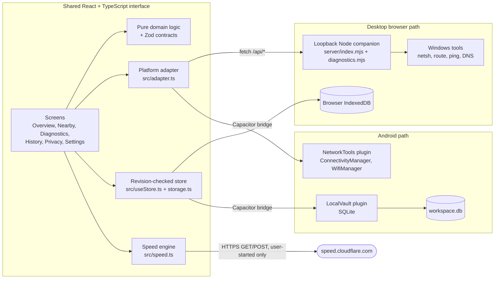

Key ideas:

- **One UI, two adapters.** Screens never know whether they run in a browser or on Android. Everything platform-specific sits behind `src/adapter.ts` (network and diagnostics) and `src/storage.ts` (persistence).
- **Contracts at every boundary.** Each response from the companion or the native plugin is parsed with a Zod schema before the UI touches it. A malformed reading becomes a visible error, not a wrong number.
- **The speed test's HTTPS traffic originates from the browser or WebView itself**, so it measures the path the user's own device has to the internet. ICMP and DNS are measured by the OS through the adapter.

## 3. Technology decisions

| Decision | Choice | Why |
|---|---|---|
| UI | React 19, strict TypeScript, Vite 8 | One codebase for browser and Android, strict types shared with the validation layer |
| Android shell | Capacitor 8 plus two Java plugins | Native APIs stay behind a small bridge; no second UI implementation |
| Validation | Zod 4 | One schema defines the type, the runtime check and the stored format |
| Charts and icons | Hand-written SVG line chart (`ui.tsx`), `lucide-react` | No charting dependency; units, gaps and sources stay explicit |
| Fonts | DM Sans Variable and Instrument Serif, bundled | No font service is called at runtime |
| Desktop sensing | Node companion bound to `127.0.0.1` | Browsers cannot read Wi-Fi state or send ICMP; a tiny local process can, without a cloud |
| Tests | Vitest, Testing Library, fake-indexeddb, Playwright (installed Chrome), axe-core | Unit and DOM tests plus real-browser, real-network checks |

**Deviation from the original brief.** The original specification proposed Kotlin, Jetpack Compose and Room. This project uses React, Capacitor and Java plugins instead, so the same interface also serves the requested local Windows workflow. This is a deliberate compatibility trade-off, not a claim that the original stack was followed. Android SQLite is used directly through a plugin rather than Room because the schema is a single validated snapshot.

## 4. Source map

| Path | Responsibility |
|---|---|
| `src/domain.ts` | Zod schemas (network snapshot, access point, diagnostic result, saved state), host validation, summaries (loss, average, jitter), signal and band labels, CSV export |
| `src/speed-domain.ts` | Speed profiles, `SpeedResult` schema, throughput formula, plain-language advice rules, speed CSV export |
| `src/speed.ts` | The browser-side speed engine: HTTPS latency probes, streamed download, random-payload upload, loaded latency, cancellation, timeouts |
| `src/adapter.ts` | `readNetwork`, `scanNetwork`, `diagnose`. Chooses native plugin or companion HTTP and validates the response |
| `src/storage.ts`, `src/useStore.ts` | Revision-checked persistence (IndexedDB or SQLite) and the React hook that owns saved state |
| `src/App.tsx` | Shell, hash routing, connection refresh, optional foreground monitoring, settings, confirmations |
| `src/SpeedTest.tsx`, `src/SpeedResult.tsx` | Speed test card (run, cancel, stages, retry-save) and speed results, history and CSV button |
| `src/Views.tsx`, `src/Diagnostics.tsx`, `src/Result.tsx`, `src/History.tsx`, `src/Privacy.tsx`, `src/ui.tsx` | Overview, nearby networks, diagnostic form, result cards, history and comparison, privacy page, shared components |
| `server/index.mjs` | Loopback HTTP server: static files, health, API routing, request guards, security headers |
| `server/diagnostics.mjs` | Windows readers and probes: `netsh`, `route`, `ping`, DNS resolution, HTTPS HEAD; output parsers |
| `native/NetworkToolsPlugin.java` | Source of truth for the Android network plugin. `npm run android:build` copies it into the Android project |
| `android/` | Capacitor Android project, `LocalVaultPlugin` (SQLite), manifest, icons |
| `scripts/` | Build helpers, APK build and verification (`android.mjs`, `verify-apk.mjs`), API and browser and speed checks, Android QA, local server start/stop |
| `.github/` | `workflows/ci.yml` (verify, build APK, publish download; section 13.1) and `dependabot.yml` |
| `tests/` | Domain, storage, adapter, speed engine and UI tests |

## 5. Platform adapters

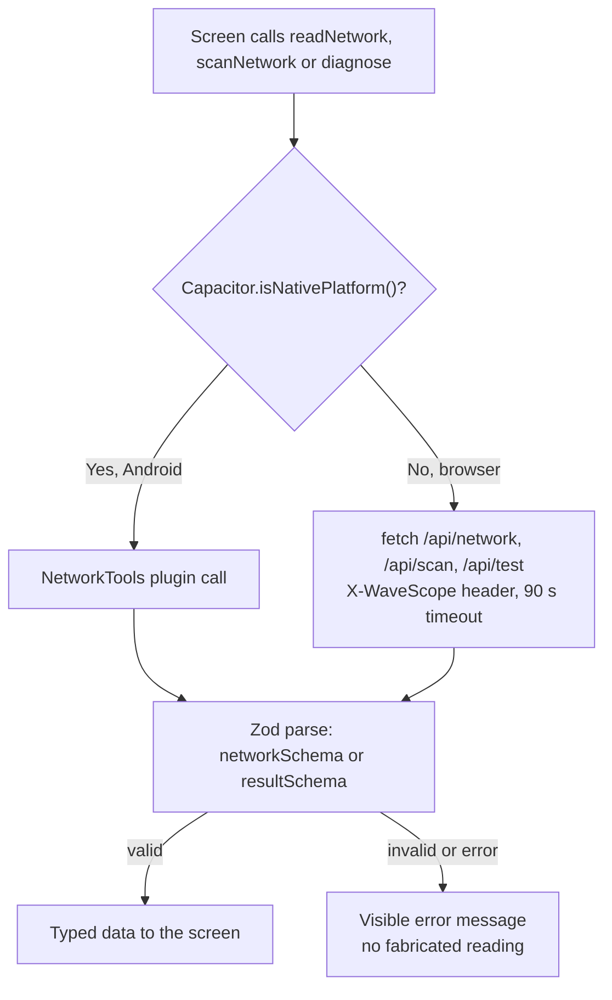

The same split exists for storage: `loadSnapshot` and `saveSnapshot` use the `LocalVault` plugin on Android and IndexedDB in the browser.

## 6. Screens and navigation

Navigation is hash-based (`#overview`, `#networks`, `#diagnostics`, `#history`, `#privacy`, `#settings`), so the browser and Android back button both work.

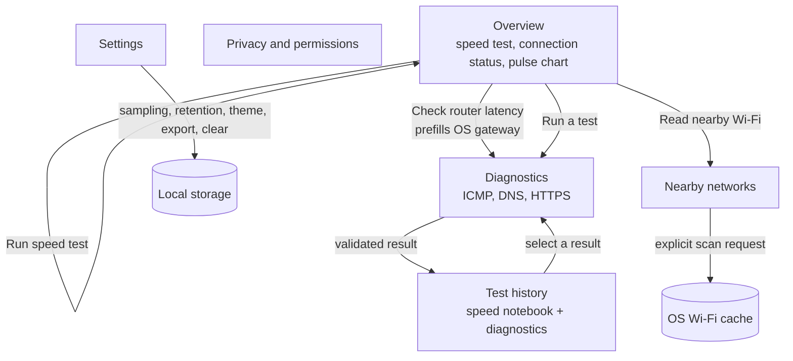

| Screen | What it provides |
|---|---|
| **Overview** | Speed test card; hero with SSID, signal, link rate, latest ICMP latency, band; connection details (gateway, local IP, DNS servers, BSSID, VPN, captive portal); live pulse chart; nearby-network preview |
| **Nearby networks** | OS-cached access point table, per-channel occupancy counts, the explanation of any OS limits |
| **Diagnostics** | Choose ICMP, DNS or HTTPS, enter a destination (validated), run explicitly, see metrics and chart |
| **Test history** | Speed notebook with comparison chart and CSV export, plus the diagnostic history with filters and export |
| **Privacy and permissions** | Exactly what is read, stored and sent, the active adapter, and its limits |
| **Settings** | ICMP count (4, 8, 12), interval (1, 2, 5 s), retention (100, 500, 1000), theme, optional foreground refresh every 15 s, export, clear |

## 7. Feature flows

### 7.1 App startup and state load

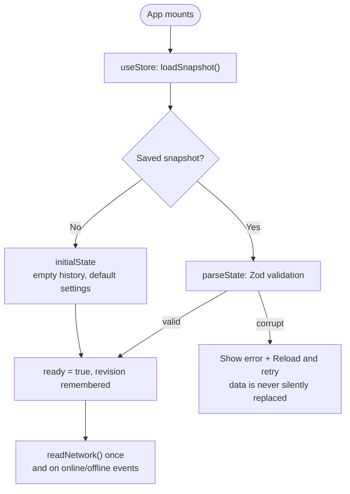

### 7.2 Connection refresh

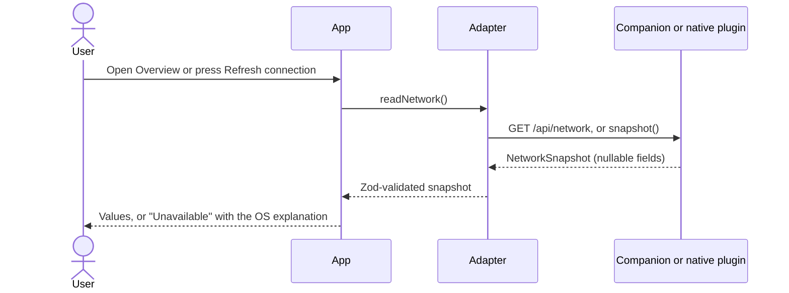

On Windows the companion combines `os.networkInterfaces()`, `dns.getServers()`, `route print 0.0.0.0` (default gateway: lowest-metric default route) and `netsh wlan show interfaces`. Snapshots are held in memory only. Optional monitoring repeats this read every 15 seconds while the app is visible; it never sends outbound probes.

### 7.3 Nearby Wi-Fi scan

The user presses **Read nearby Wi-Fi** and confirms a dialog that explains location permission and OS throttling. Only then does the adapter call `POST /api/scan` or the native `scan()`. Windows returns its cached `netsh wlan show networks mode=bssid` list. Android asks for foreground location permission at that moment; denial leaves the rest of the app working. The result may be empty or throttled, and the UI says so.

### 7.4 Individual diagnostics (ICMP, DNS, HTTPS)

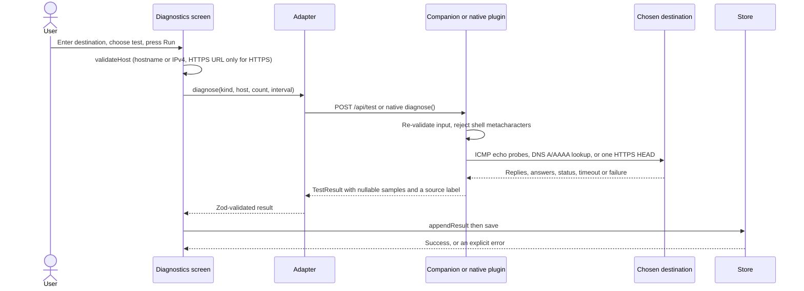

| Test | What is measured | How a failure appears |
|---|---|---|
| **ICMP** | `count` real OS ping probes, one per interval | `null` sample (timeout or blocked); loss is derived from nulls. Jitter is the mean absolute difference between successive successful samples |
| **DNS** | A and AAAA resolution through the configured resolver, 7 s limit | One `null` sample plus an explanation |
| **HTTPS** | One HEAD request, redirects not followed, 8 s limit, includes TLS | One `null` sample plus an explanation |

DNS and HTTPS durations are labeled separately from ICMP and must not be read as ping latency.

### 7.5 Speed test

The Overview speed test is the app's all-in-one check. It answers: *is my internet working, how fast and responsive is it, and does it stay responsive when busy?* Running it during a Wi-Fi versus Ethernet comparison, or at different spots in a house, also helps separate router and Wi-Fi problems from ISP problems.

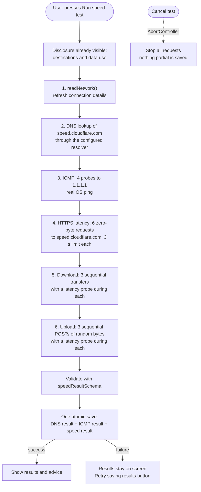

**Sizes.** The size selector controls how much payload is sent. Protocol overhead is extra.

| Profile | Download transfers | Upload transfers | Payload |
|---|---|---|---|
| Quick (default) | 1, 4, 8 MB | 0.25, 1, 2 MB | 13 + 3.25 = 16.25 MB, labeled "up to 17 MB" |
| Extended | 2, 8, 16 MB | 1, 4, 8 MB | 26 + 13 = 39 MB, labeled "up to 39 MB" |

**What each number means.**

| Metric | Definition |
|---|---|
| Download / upload (Mbps) | Total payload bits divided by total transfer time across the three sizes, over a single HTTPS stream. Upload time includes the server's acknowledgement |
| HTTPS latency (ms) | Mean of up to six zero-byte request round trips. Includes TLS and browser overhead, so it is higher than ICMP. It is labeled "not ICMP" |
| HTTPS jitter (ms) | Mean absolute difference between successive successful HTTPS probes |
| HTTPS reachability | Successful probes out of six. A failed probe is **not** reported as packet loss |
| Loaded latency (ms) | A latency probe sent while a download or upload is running. The gap from idle latency shows bufferbloat (queueing in the router or modem under load) |
| ICMP result | Separate Round-trip latency card: average, loss, jitter, responses, from real OS ping to 1.1.1.1 |
| DNS time | Separate history entry for the lookup of the speed-test host |

**Advice engine** (`speedAdvice` in `src/speed-domain.ts`) returns the first matching message:

1. No successful HTTPS probe: endpoint unreachable, check internet access, VPN or a sign-in portal.
2. Any measurement did not finish: results use only what completed; retry or compare with another connection.
3. Loaded latency more than 50 ms above idle: pause heavy transfers or review router queue management.
4. Idle HTTPS latency above 100 ms: compare Ethernet, another Wi-Fi band or a nearer network.
5. Otherwise: repeat on Wi-Fi and Ethernet to compare; one endpoint cannot certify every service.

**Guardrails.**

- Nothing runs on page load. A test sends traffic only after the button press (checked by the browser test: zero requests to the speed host when Overview opens).
- Every request uses `cache: 'no-store'`, `credentials: 'omit'`, `redirect: 'error'` and `referrerPolicy: 'no-referrer'`, with a cache-busting nonce on downloads.
- Per-transfer timeout 8 s; whole test timeout 80 s; downloads that return the wrong byte count or exceed the expected size are rejected; upload response bodies are capped at 64 KB.
- **Slow and unstable links still produce a result.** Transfers run smallest first. Before each larger transfer the engine predicts its duration from the throughput measured so far and skips it if it could not finish inside the 8 s limit. If a larger transfer fails or times out, the completed transfers are kept. Either way the result is computed from what finished, and the "Partial result" line says how many of the three transfers ran and why it stopped. Only a failure of the *first* transfer in a direction leaves that direction unavailable. A cancellation or the 80 s overall limit still discards everything.
- Cancelling aborts every request. An in-flight OS ping cannot be interrupted and finishes within its own timeout.
- The destination is a fixed constant (`SPEED_ORIGIN`) enforced by the schema, so a saved result cannot claim another origin.
- One endpoint is measured. Different servers, routing and CDNs give different numbers, which the UI says.

**Speed history.** Results are stored as `speedHistory` (newest first, bounded by the retention setting), shown in an expandable notebook with a download-speed comparison chart for the chosen profile, and exportable as `WaveScope-speed-tests.csv`.

### 7.6 Saving data

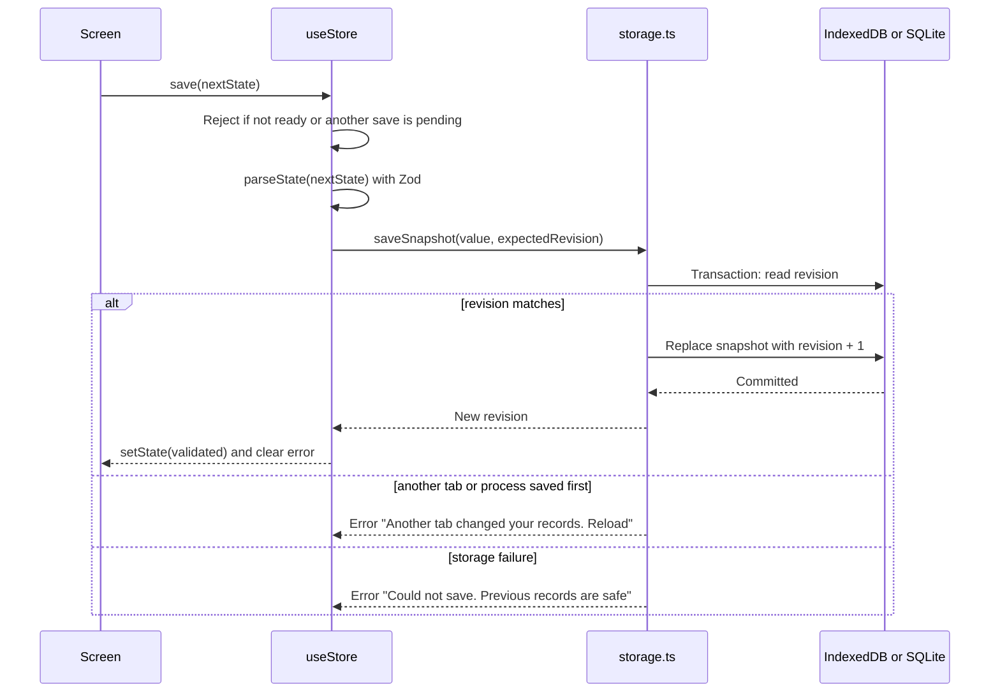

The screen state changes only after a durable write succeeds.

### 7.7 Export and clearing

History export builds RFC 4180 style CSV (`WaveScope-diagnostics.csv`, `WaveScope-speed-tests.csv`). In a browser it downloads a Blob. On Android it writes to the app cache through the `LocalVault.exportFile` method and opens the share sheet through a restricted `FileProvider`. Clearing history asks for confirmation and removes both diagnostic and speed history in a single save.

## 8. Domain model and persistence

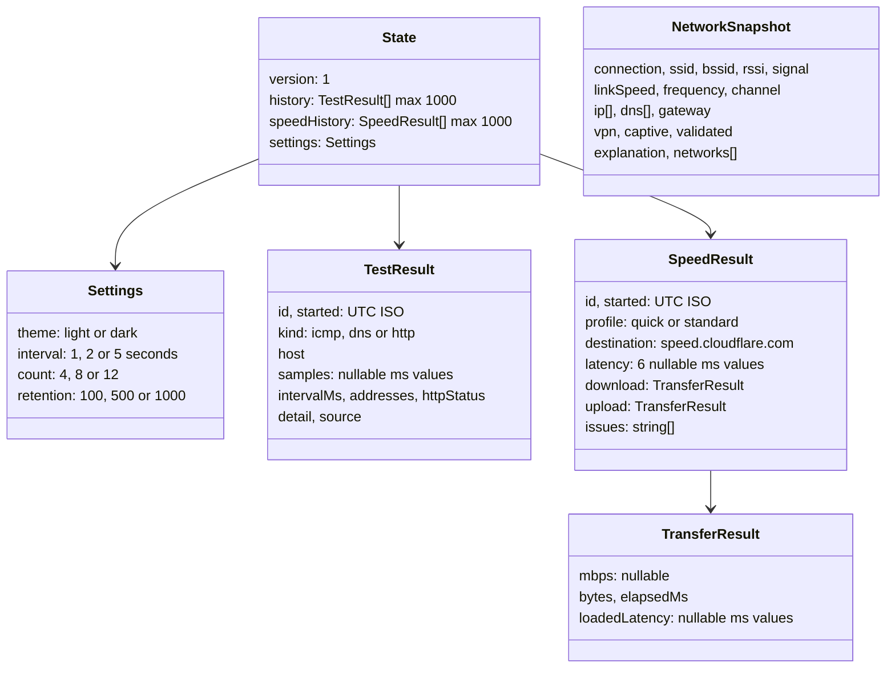

`NetworkSnapshot` and its access-point list are **never persisted**; they live in React memory only.

| Rule | Detail |
|---|---|
| Missing data | A sample or field the platform cannot supply is `null`, rendered as a gap or "Unavailable", never as zero or an estimate |
| Time | Timestamps are UTC ISO strings internally, localized only for display |
| Sources | Each result records where its value came from (for example "Windows companion" or "Android OS") |

**Browser store.** IndexedDB database `private-workspace-v1`, object store `snapshots`, key `state`, value `{ revision, value }`.

**Android store.** `workspace.db` v1: `snapshot(id INTEGER PRIMARY KEY CHECK(id = 1), revision INTEGER NOT NULL, json TEXT NOT NULL)`.

**Concurrency.** A transaction reads the stored revision and replaces the snapshot only if it equals the revision the caller started from, so a stale tab cannot overwrite newer data.

**Migration.** The state `version` is the literal `1`. `speedHistory` was added later with a schema default of `[]`, so snapshots saved before the speed test existed still load. A future schema change must transform the validated v1 state explicitly, inside a transaction, before raising the version. Unknown or corrupt state is never silently replaced.

**Retention.** The newest 100, 500 or 1000 entries are kept, applied to each history separately. Reducing retention trims both. Android OS cloud backup is disabled (`allowBackup="false"`).

## 9. Local companion API

The companion is a plain Node process (`server/index.mjs`) that serves the production build from `dist/` and exposes four endpoints. It binds only to `127.0.0.1`, port 5182 by default (`PORT` overrides).

| Endpoint | Method | Purpose |
|---|---|---|
| `/api/health` | GET | Readiness. Returns `{"status":"ok","app":"WaveScope"}`. Readiness is judged by this response, never by log output |
| `/api/network` | GET | Current OS connection data as a `NetworkSnapshot` |
| `/api/scan` | POST | OS-cached nearby access point list. Contacts no user-supplied host |
| `/api/test` | POST | Body `{ kind, host, count, interval }` where `kind` is `icmp`, `dns` or `http`, `count` is 4, 8 or 12, `interval` is 1, 2 or 5 |

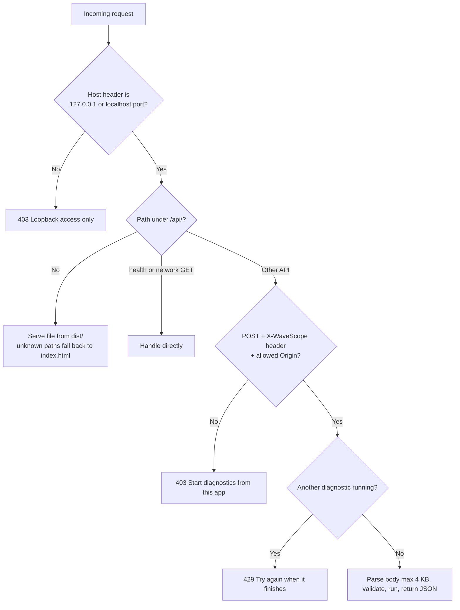

Every response carries `X-Content-Type-Options: nosniff`, `Referrer-Policy: no-referrer` and a Content-Security-Policy. The CSP allows scripts, styles, fonts and images from the app itself and widens `connect-src` only to `https://speed.cloudflare.com` for the speed test. Errors returned to the browser are generic; destinations, SSIDs and samples are never logged.

On Windows the companion shells out only through `execFile` with argument arrays (no shell): `ping.exe`, `netsh.exe`, `route.exe`. Hostnames and IPv4 addresses are validated with strict patterns first.

## 10. Android native layer

| Component | Role |
|---|---|
| `MainActivity` | Capacitor `BridgeActivity` hosting the WebView |
| `NetworkToolsPlugin` (`snapshot`, `scan`, `diagnose`) | Reads connection state through `ConnectivityManager` and `WifiManager`, requests foreground location only for scans, runs ICMP, DNS and HTTPS probes on a worker thread, returns domain-shaped JSON |
| `LocalVaultPlugin` (`load`, `save`, `exportFile`) | App-private SQLite snapshot with revision check, and share-sheet export through `FileProvider` |

Manifest permissions: `INTERNET`, `ACCESS_NETWORK_STATE`, `ACCESS_WIFI_STATE`, `CHANGE_WIFI_STATE`, and fine and coarse location (requested at runtime only when the user starts a nearby scan).

| Feature | Permission and destination | Denied or offline behavior |
|---|---|---|
| Connection status | `ACCESS_NETWORK_STATE`, `ACCESS_WIFI_STATE` | Redacted fields stay Unavailable |
| Nearby Wi-Fi | `CHANGE_WIFI_STATE` plus contextual foreground location | Clear error; no fake scan data; Android throttles scans |
| ICMP, DNS, HTTPS, speed test | `INTERNET`; destination shown before the user starts | Timeouts and failures are saved as `null` samples. Nothing runs automatically |

The speed test's HTTPS requests run inside the WebView, so they use the phone's current network (Wi-Fi or mobile data). The speed test card warns that it can use mobile data.

## 11. Privacy, security and data egress

**What leaves the device, and only when the user presses a button:**

| Action | Destination | What is sent |
|---|---|---|
| Open app, refresh, nearby scan, monitoring | Nothing external | Local OS reads only |
| ICMP diagnostic | The chosen host | ICMP echo requests |
| DNS diagnostic | The configured resolver | A and AAAA query for the chosen hostname |
| HTTPS diagnostic | The chosen HTTPS URL | One HEAD request, redirects not followed |
| Speed test | `speed.cloudflare.com` | HTTPS GET and POST with random payload, no cookies or credentials, no referrer. Cloudflare sees the public IP |
| Speed test | `1.1.1.1` | Four ICMP echo requests |
| Speed test | Configured resolver | DNS lookup for `speed.cloudflare.com` |

Fonts ship locally. There are no accounts, analytics, advertising or crash uploads.

**Threat model.**

| Threat | Mitigation |
|---|---|
| Malicious destination text (command injection) | Strict hostname and IPv4 patterns on client and server; `execFile` with argument arrays; automated test sends injection strings |
| Other websites calling the local API | Loopback bind, Host and Origin checks, required custom header, POST-only mutations, request size cap, single concurrent job |
| XSS | No untrusted HTML rendered; CSP with `script-src 'self'` |
| Speed endpoint misbehavior | Fixed origin, byte-count checks, response caps, per-request and total timeouts |
| Stale or concurrent writes | Optimistic revision checks; UI updates only after durable writes |
| Corrupt stored data | Zod validation on load; error shown rather than silent replacement |
| Cached app page masquerading as a failed external request | The service worker handles only same-origin GET requests outside `/api/` |
| Secrets | None exist: no accounts, tokens or keys. The only configuration is the optional `PORT` environment variable, documented in `.env.example` (the server reads the process environment, not a `.env` file) |

Anyone with access to the OS user or browser profile can read local app data. This is a single-user tool, not a multi-tenant service. Android app-private SQLite relies on OS sandboxing; full-device encryption depends on the device.

Operational notes: no telemetry or collector exists. A browser-installed service worker (`dist/sw.js`, generated by `scripts/offline.mjs`) caches same-origin app assets for offline reload and is registered only on plain `http:` (the loopback companion).

## 12. Design and accessibility

The direction is a daylight utility workspace: persistent navigation, restrained slate-blue and grey semantic colors, compact technical values, honest empty states, and an optional dark theme. Navigation scrolls horizontally on narrow screens, tables scroll inside their own region, and layouts target 320 px width. Controls have visible focus states, semantic labels, named icon buttons and touch targets of at least 44 px. Motion is limited to CSS interaction states and respects reduced-motion preferences.

Design references reviewed on 2026-11-03: Realtime Colors (semantic palette roles), 21st.dev (navigation patterns), Motion (reduced-motion guidance). No third-party layout or component was copied. Axe-core runs against WCAG 2.0 to 2.2 A and AA rules in both themes with zero violations. Manual screen-reader, zoom and text-scaling checks are still pending.

## 13. Build, test and release pipeline

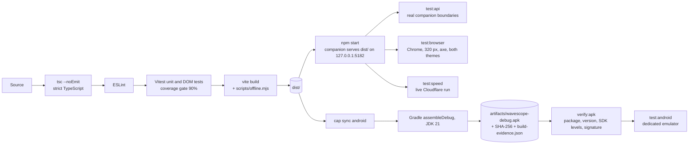

| Command | What it proves |
|---|---|
| `npm run check` | Typecheck, ESLint, unit and DOM tests, production build |
| `npm run test:coverage` | Same tests plus a 90% minimum on statements, branches, functions and lines for `src/` (native Java excluded) |
| `npm run test:api` | Health, static root, OS snapshot, request guards, injection rejection, real ICMP, cached scan, against the running companion |
| `npm run test:browser` | Real Chrome: companion status, real ICMP with history surviving reload, desktop and 320 px layouts, dark theme, axe accessibility |
| `npm run test:speed` | Real Chrome and **live internet**: no traffic on page open, full speed test, real ICMP and DNS history, persistence across reload, CSV download, 320 px history layout, cancellation, router shortcut, axe |
| `npm run verify:apk` | The built APK has the expected package, version name and code, a launch activity, min and target SDK, and a valid v2 signature (`scripts/verify-apk.mjs`) |
| `npm run test:android` | APK install and launch on a dedicated emulator, native connection data, ICMP history, SQLite persistence across force-stop |
| `npm audit --omit=dev` | Known vulnerabilities in production dependencies |

The browser, speed and Android-emulator checks need Chrome, live internet or an emulator, so they are run locally and recorded in section 16. GitHub Actions runs everything that can run on a clean Linux machine, as described next.

Browser, speed and Android evidence is written under `qa/`, which is git-ignored.

### 13.1 Release automation

One workflow, `.github/workflows/ci.yml`, verifies the code and publishes a download on every push to `main` (and `master` until the default branch is renamed), and an official release for every version tag. The README links to fixed URLs, so it never needs editing when a new build is published.

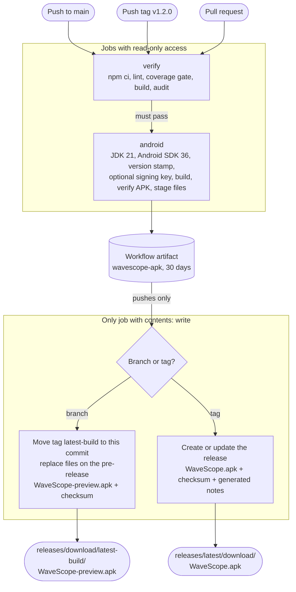

| Concern | Design |
|---|---|
| **Stable links** | The preview lives on a pre-release whose tag, `latest-build`, is moved to each new commit while its files are replaced in place, so the URL never breaks between builds. It can never become GitHub's "latest release". Official releases use the fixed name `WaveScope.apk`, which GitHub serves at `releases/latest/download/` |
| **Nothing publishes from a failing commit** | `android` needs `verify`, and `publish` needs `android`. A failed lint, test, coverage gate, audit, build or APK verification stops the run before any release changes |
| **One version source** | `package.json` is the only place the version is written. Vite injects it into the UI footer (`__APP_VERSION__`), and `scripts/android.mjs` passes it to Gradle. Preview builds are stamped `1.0.0-build.<run number>`. A tag build requires the tag to equal `package.json`, otherwise the run fails with an explicit message |
| **Android updates** | `versionCode` is the workflow run number, so it only ever increases. Renaming the workflow file restarts that count and would stop updates, so the file keeps its name |
| **Signing** | With four optional repository secrets (`ANDROID_KEYSTORE_BASE64`, `ANDROID_KEYSTORE_PASSWORD`, `ANDROID_KEY_ALIAS`, `ANDROID_KEY_PASSWORD`) the debug build type is signed with that stable key and each build installs over the last. Without them Gradle generates a throwaway debug key on every CI machine, so builds cannot update in place and users must uninstall first. `build-evidence.json` records which mode was used. Secrets are withheld from pull requests |
| **Least privilege** | Workflow default is `contents: read`. The jobs that run `npm ci`, scripts and Gradle can only read. A separate `publish` job holds `contents: write`, runs no project code and only moves a tag and uploads two files |
| **No script injection** | No `${{ }}` expression is interpolated inside a shell script. Values reach scripts through environment variables only |
| **Concurrency** | Pushes queue and are never cancelled mid-publish. Only superseded pull-request runs are cancelled. The publish job is serialized |
| **Integrity** | Each download has a `sha256sum`-format checksum file. `verify-apk.mjs` runs before staging |
| **Dependencies** | Dependabot proposes weekly npm, Gradle and GitHub Actions updates. Actions are pinned to major versions, not commit hashes |

Not yet exercised on GitHub: the workflow has been checked locally (YAML parse, shell syntax of every script, the version-selection and staging scripts, the APK verifier on passing and failing input, and the optional signing path with a throwaway key) but its first real run happens on the first push. The links in the README assume the repository is `gopichandchikoti/WaveScope`.

## 14. Requirements traceability

The original specification required these v1.0 capabilities, and the same rules require anything unfinished to be flagged rather than omitted.

| Required capability | Status | Where |
|---|---|---|
| Current network dashboard (type, SSID/BSSID where permitted, RSSI, link speed, band, IP/DNS) | Implemented, conditional | OS and permission dependent. Windows reports signal percent, not RSSI |
| Connection status; Wi-Fi vs cellular vs VPN vs captive portal | Implemented, conditional | VPN is heuristic on Windows. Captive portal and validated internet are Android-only |
| Ping latency, loss and jitter to user-chosen hosts, from real probes | Implemented | Diagnostics ICMP |
| DNS and HTTP reachability, clearly distinct from ping | Implemented | Diagnostics DNS and HTTPS |
| Wi-Fi scan list and channel views where the platform allows | Implemented, conditional | OS-cached scans; counts per channel, not a spectrum view |
| History of user-started tests with timestamps and comparison charts | Implemented | Test history |
| Change monitoring when allowed, manual refresh, text/CSV export | Implemented | Foreground-only refresh, online/offline events, CSV exports |
| Privacy page and local-first storage | Implemented | Privacy screen; IndexedDB and SQLite |
| Accessible graphs, troubleshooting explanations, sampling settings | Implemented | Chart captions with units and gaps; advice engine; Settings |
| **Added beyond spec:** one-button speed test (download, upload, HTTPS latency, jitter, loaded latency, ICMP, DNS), speed history and CSV, OS gateway and router-latency shortcut | Implemented | Section 7.5 |
| Android 12 to 16 device matrix on physical hardware | **Not done** | Emulator only |
| Signed release build | **Not done** | Debug-signed APK only |

## 15. Known limitations

- **Android hardware.** Only an Android 15 emulator has run the app. Physical phones, Android 12 to 16, radio behavior, permission flows, battery and assistive technology are untested.
- **Android speed test and gateway.** The speed test and the gateway field were added after the last emulator run. The rebuilt APK compiles, but these features have not yet been exercised on Android.
- **Windows.** RSSI is not inferred from signal percentage. Wi-Fi fields need Wi-Fi hardware and Location services. VPN detection uses adapter names.
- **Speed test.** Single endpoint, single stream: it is not a certified benchmark and can read lower than multi-stream tools on fast links. It does not find the nearest server. Upload includes server acknowledgement. Very short transfers may yield no loaded-latency sample. On very slow links the throughput comes from the smaller transfers only, which includes TCP start-up time and reads lower than the link's steady rate. The first 1 MB download and 250 KB upload must finish within 8 s, so links below roughly 1 Mbps down or 0.25 Mbps up report that direction as unavailable.
- **ICMP.** Firewalls can block it. Windows reports 1 ms resolution, so fast replies appear as 1 ms or less.
- **Router.** The app reports the OS default gateway and can time it; it never logs in to a router or reads router internals.
- **Manual accessibility.** Screen reader, zoom, text scaling and landscape checks are pending.
- **Release.** A store release needs a protected signing key created outside the repository.

## 16. Verification evidence

Run on 2026-11-05 on the current working tree. Re-run on the exact revision you intend to ship.

| Check | Result | Scope and qualification |
|---|---|---|
| `npm run check` | Passed | Typecheck, ESLint, 50 tests in 11 files, production build |
| `npm run test:coverage` | Passed, gate is 90% | Statements 96.92%, branches 93.66%, functions 95.47%, lines 98.22%. Native Java excluded |
| `npm run test:api` | Passed (8 named checks) | Real local companion: health and static root, OS snapshot schema, cross-origin denial, missing-header denial, command-injection rejection, invalid-sampling rejection, real loopback ICMP, cached scan |
| `npm run test:browser` | 5 checks passed | Real Chrome: companion status, real ICMP and history after reload, desktop and 320 px layout, dark theme; zero axe violations |
| `npm run test:speed` | 4 checks passed | Real Chrome against live Cloudflare: 72.4 Mbps down, 25.6 Mbps up on the author's connection, 6 of 6 HTTPS probes, loaded latency samples, 4 ICMP replies, DNS entry; no external requests on page open; reload persistence, CSV download, 320 px layout, cancellation, gateway shortcut; zero axe violations. Numbers are one run on one network, not a benchmark. Repeated runs on the same connection ranged from about 70 to 100 Mbps down and 14 to 31 Mbps up |
| Slow-link behavior | Unit-tested only | Fake-clock tests cover skipping oversized transfers and keeping completed ones. It has not been exercised on a genuinely slow or throttled network |
| `npm audit --omit=dev` | 0 vulnerabilities | Production dependencies, which is what ships and what CI gates on. A full `npm audit` reports one moderate advisory in a transitive `minimatch` used by the typescript-eslint lint toolchain (dev only, never bundled); npm's suggested fix is a downgrade, so it is left alone |
| `npm run android:build` and `npm run verify:apk` | Passed with JDK 21.0.11 | Includes the speed and gateway changes. `artifacts/wavescope-debug.apk`, 4,368,269 bytes, SHA-256 `35bf7bd55fd199b0c2f8effe9ad86832221803760bb4e68dece560711d5d4d6b`, package `com.portfolio.wavescope`, version 1.0.0 (code 1), min SDK 26, target SDK 36, launch activity present, APK signature v2 verified, signed with the per-machine debug key. The APK holds exactly one JS and one CSS bundle, matching `dist/`. Not installed after this build |
| Release automation, local simulation | Passed | A CI-style build with `WAVESCOPE_VERSION_NAME=1.0.0-build.77` and `WAVESCOPE_VERSION_CODE=77` produced an APK with exactly those values (verified by `verify-apk.mjs`, which also fails with exit 1 on a wrong expected code) and the stamped version in the UI bundle. The optional stable-signing path was run with a throwaway keystore: the APK was signed by that certificate instead of "Android Debug", and `build-evidence.json` recorded "stable preview key". The version-selection script was run for a branch push, a matching tag, a mismatched tag and a malformed tag (the last two fail with clear errors). The staging script was run in preview and tag modes and both checksum files validate. The workflow YAML parses and is Prettier-clean, all 7 shell scripts pass `bash -n`, every `needs` resolves, and no `${{ }}` expression appears inside a script |
| Release automation on GitHub | **Not yet run** | The workflow has never executed on GitHub, so the Android SDK step on the runner, the `latest-build` tag move, the release upload and the README download links are unproven until the first push. `actionlint` was not run (an external binary download was declined). The README links assume the repository is `gopichandchikoti/WaveScope` |
| Android emulator | Not rerun for this build | An earlier APK (before the speed test) passed six emulator checks on Android 15 on 2026-11-05. No emulator dedicated to WaveScope is configured on the build machine |
| Physical Android 12 to 16, manual assistive technology, device performance | Not tested | Open |
| Signed distribution APK, Play Store | Not done | The APK is debug-signed |

## 17. Extending WaveScope

**Add a diagnostic type.** Add the kind to `resultSchema` in `src/domain.ts`; validate its input in `validateHost` and in `server/diagnostics.mjs`; implement it in the companion and in `NetworkToolsPlugin.java`; add labels in `Result.tsx` and `Diagnostics.tsx`; add domain, adapter and UI tests; update sections 7 and 9.

**Add a speed metric or profile.** Extend `speedProfiles` or `speedResultSchema` in `src/speed-domain.ts` (use a schema default so existing stored data still loads), measure it in `src/speed.ts`, render it in `src/SpeedResult.tsx`, add it to `exportSpeed`, and update the data-use text in `SpeedTest.tsx` and `Privacy.tsx` if traffic changes.

**Change the stored schema.** Never edit `stateSchema` in a breaking way. Raise `version`, write an explicit transform from the previous validated state, run it inside the storage transaction, and add a migration test.

**Documentation rule.** Keep this file and the README as the only project documents. Merge new material into them instead of adding files.
